# Memoria de la práctica: servidor DNS paso a paso

[Volver al README principal](../README.md)

**Autor:** Raúl Calvo Santos  
**Curso:** 2.º de Desarrollo de Aplicaciones Web  
**Formación previa:** Sistemas Microinformáticos y Redes

## 1. Introducción y objetivos

En esta práctica he configurado un servidor DNS con BIND9 en Debian. Viniendo de SMR, la parte de direccionamiento IP, las redes privadas y las comprobaciones de conectividad me resulta familiar. En DAW, relaciono esos conocimientos con el acceso a las aplicaciones web mediante nombres en lugar de direcciones IP.

El objetivo es resolver los nombres de mi zona `raul.test`, realizar la resolución inversa y comprobar los registros desde Windows. También preparo la configuración para poder repetirla con Vagrant y guardo los avances mediante Git.

La memoria sigue el enunciado «Configuración de un servidor DNS paso a paso» y las capturas de mi proceso. Cuando una captura no acredita una comprobación completa, lo indico expresamente.

## 2. Fundamentos y entorno

DNS organiza los nombres de forma jerárquica. En `debian.raul.test.`, el punto final representa la raíz, `test` es el dominio superior, `raul.test` es mi zona y `debian` identifica al equipo. El nombre completo del servidor es su FQDN.

Mi servidor es autoritativo para `raul.test` y para la zona inversa de la red privada. Para los nombres externos permite consultas recursivas desde los equipos de confianza. Esto permite utilizarlo tanto para los nombres de la práctica como para resolver dominios externos.

| Parámetro | Valor |
| --- | --- |
| Anfitrión y cliente | Windows |
| Terminales del anfitrión | CMD, PowerShell y Git Bash, según la fase |
| Servidor | Debian 12, box `debian/bookworm64` |
| Servicio DNS | BIND9, servicio `named` |
| Red privada | `192.168.56.0/24` |
| IP del servidor | `192.168.56.10` |
| Zona directa | `raul.test` |
| Zona inversa | `56.168.192.in-addr.arpa` |
| Nombre del servidor | `debian.raul.test` |
| Alias web | `web.raul.test` |
| Usuario de GitHub | `raulcalvosantos2007-lang` |

La IP `.1` queda reservada al adaptador del anfitrión, como indica el enunciado. La máquina también dispone de una interfaz NAT, que le permite acceder a Internet.

| Dónde trabajo | Directorio |
| --- | --- |
| Windows: proyecto y comandos Git/Vagrant | `C:\Users\Raulcs007\dns-paso-a-paso` |
| Debian: proyecto compartido con Windows | `/vagrant` |
| Debian: opciones y declaración de zonas | `/etc/bind` |
| Debian: archivos de zona | `/var/lib/bind` |
| Debian: opciones de arranque | `/etc/default` |

## 3. Creación del repositorio y organización

En Windows creé la carpeta del proyecto, inicialicé Git y utilicé `main` como rama principal. Preparé `doc/img`, `files` y `config` para separar la memoria, las capturas, las configuraciones y los scripts.

**CMD de Windows, desde la carpeta del proyecto:**

git init
git branch -M main
mkdir doc
mkdir doc\img
mkdir files
mkdir config

Las carpetas existentes no necesitan crearse otra vez. Git registra archivos, por lo que una carpeta vacía no aparece en el repositorio hasta que contiene algún archivo versionado.

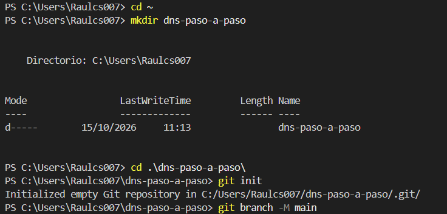

*Captura 1: Creación de la carpeta e inicialización de Git.*

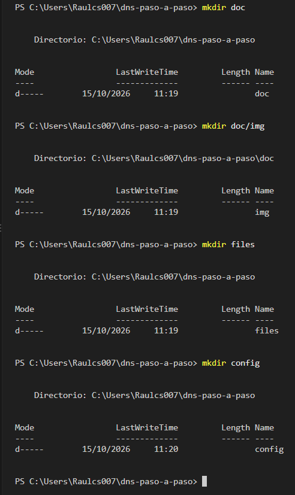

*Captura 2: Creación de las carpetas de trabajo.*

Creé un README principal con el título y el autor, y un `.gitignore` con este contenido:

gitignore
.vagrant/

El README principal enlaza a `doc/README.md`. Desde la memoria, cada imagen se referencia mediante una ruta relativa como `img/1.png`.

En Git Bash utilicé `cat` para crear archivos. En CMD ese formato no funciona: allí utilicé el Bloc de notas. El carácter `#` en un README crea un título Markdown; no es necesario comentar el texto para guardarlo.

notepad README.md
notepad doc\README.md

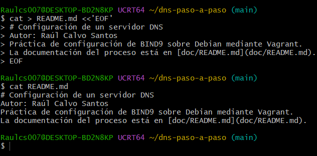

*Captura 3: Creación y lectura del README principal.*

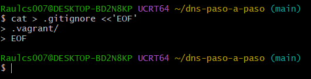

*Captura 4: Configuración de gitignore.*

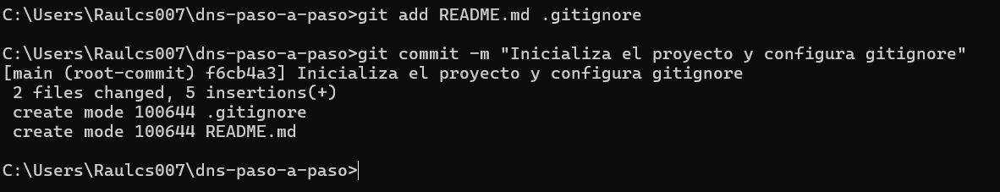

*Captura 5: Primer commit del proyecto.*

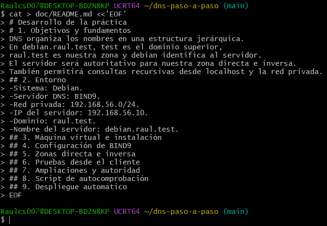

*Captura 6: Estructura inicial de la memoria.*

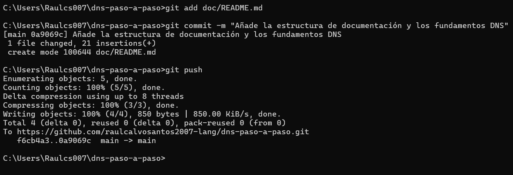

*Captura 7: Commit y envío de la documentación a GitHub.*

El repositorio se trabaja como privado, tal como exige el enunciado. Las capturas muestran commits y envíos a GitHub; su visibilidad se comprueba en la configuración del propio repositorio.

Para cada avance utilicé `git add`, `git commit` y `git push`. Si Git no reconoce al autor, hay que configurar `user.name` y `user.email` antes de confirmar los cambios.

## 4. Máquina virtual con Vagrant

**Windows, directorio del proyecto.** La configuración inicial de la máquina es:

ruby
Vagrant.configure("2") do |config|
  config.vm.box = "debian/bookworm64"
  config.vm.hostname = "debian"

  config.vm.network "private_network", ip: "192.168.56.10"

  config.vm.provider "virtualbox" do |vb|
    vb.memory = 1024
    vb.cpus = 1
  end
end

En la primera versión escribí un guion en la IP (`192.168.56-10`). Lo corregí por un punto antes de arrancar, ya que no era una dirección IPv4 válida.

vagrant validate
vagrant up
vagrant ssh

`vagrant up` arranca la máquina y `vagrant ssh` abre una sesión dentro de Debian.

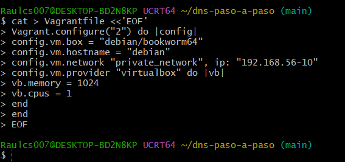

*Captura 8: Redacción inicial del Vagrantfile, con la IP que hubo que corregir.*

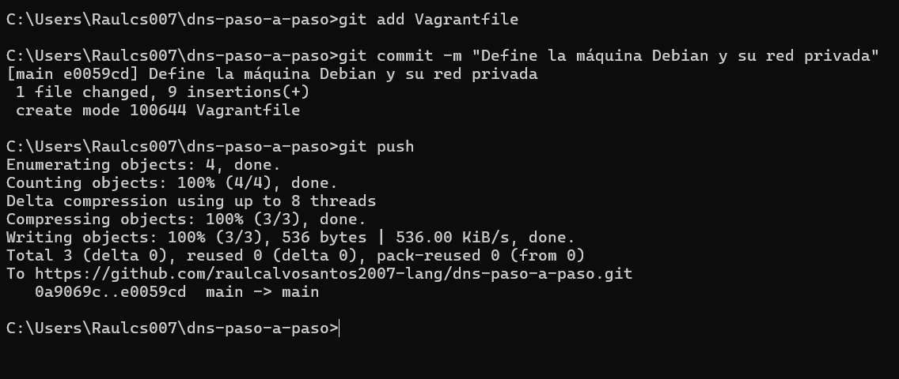

*Captura 9: Registro del Vagrantfile en Git.*

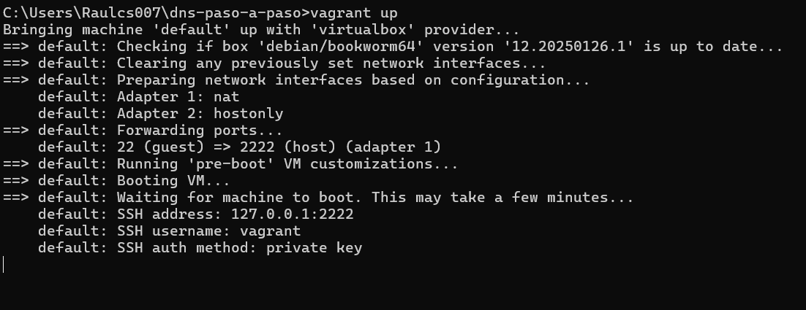

*Captura 10: Arranque de la máquina con VirtualBox.*

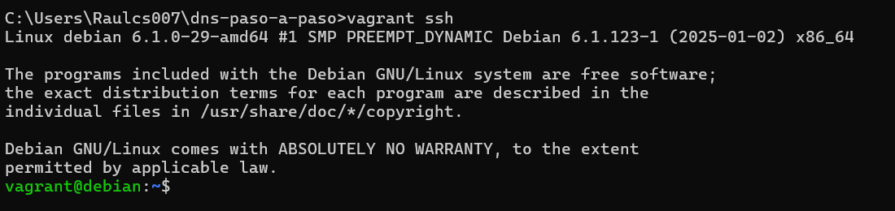

*Captura 11: Acceso SSH a Debian.*

**Debian, directorio `/home/vagrant`:**

cd /home/vagrant
ip -4 address
ls /vagrant

Comprobé que la interfaz privada tiene `192.168.56.10/24` y que `/vagrant` permite acceder a los archivos del proyecto de Windows.

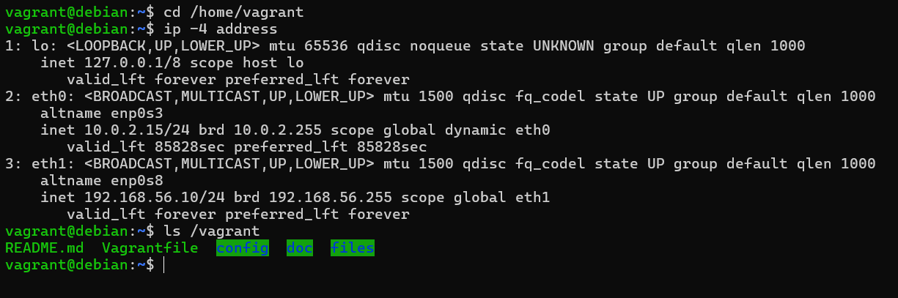

*Captura 12: Comprobación de interfaces IPv4 y carpeta compartida.*

## 5. Instalación de BIND9

Antes de las pruebas hay que revisar que no existan entradas antiguas de esta práctica en los archivos `hosts`. En Windows se encuentra en `C:\Windows\System32\drivers\etc\hosts` y en Debian en `/etc/hosts`. No se deben eliminar las entradas normales del sistema.

**Debian, desde `/home/vagrant`:**

sudo apt-get update
sudo apt-get install -y bind9 bind9utils bind9-doc dnsutils
sudo systemctl status named --no-pager

`bind9` instala el servidor, `bind9utils` aporta herramientas de validación, `bind9-doc` su documentación y `dnsutils` las herramientas de consulta usadas en Debian.

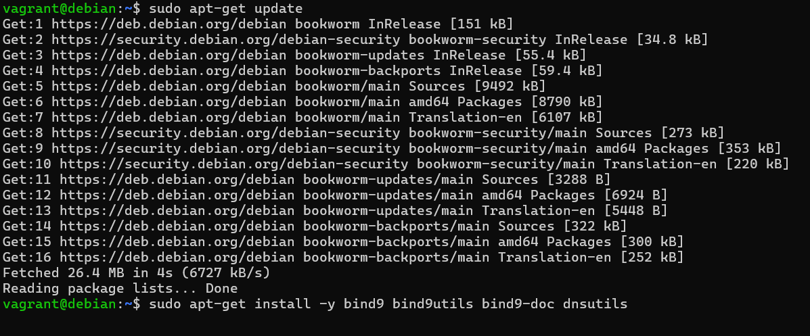

*Captura 13: Actualización de repositorios e instalación de paquetes.*

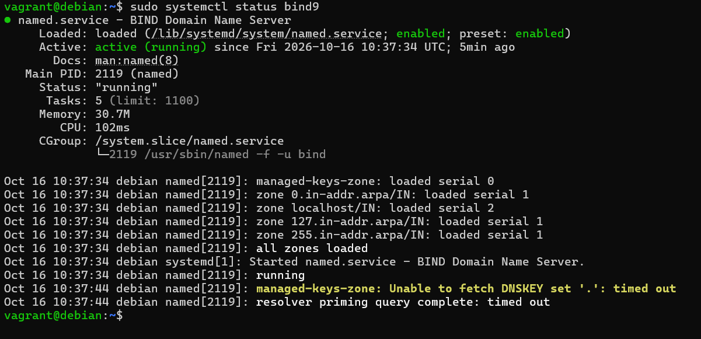

*Captura 14: Primer estado del servicio named.*

En el primer estado del servicio aparece un aviso de tiempo de espera en una consulta inicial. El servicio está activo; más adelante la consulta externa correcta permite comprobar que la resolución funciona en el momento de esa prueba.

Preparé también `config/01-instalar.sh` para repetir la instalación:

#!/usr/bin/env bash
set -euo pipefail
export DEBIAN_FRONTEND=noninteractive
apt-get update
apt-get install -y bind9 bind9utils bind9-doc dnsutils

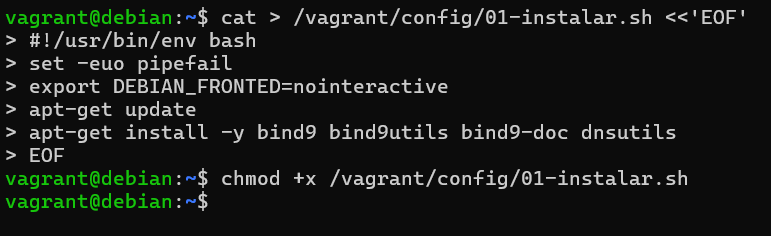

*Captura 15: Creación del script de instalación en la carpeta compartida.*

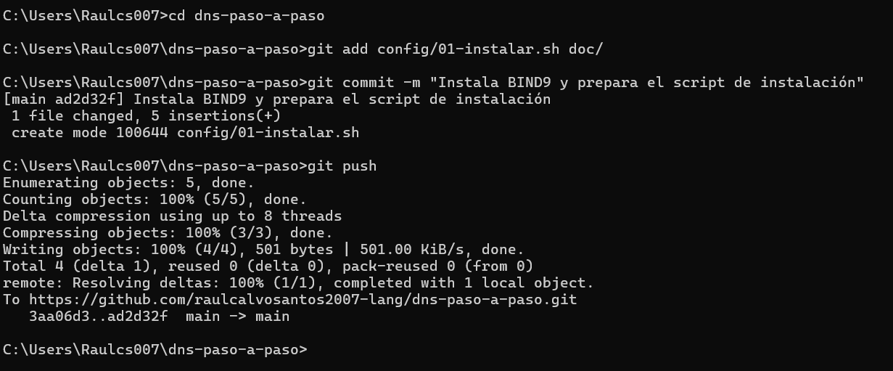

*Captura 16: Commit del script de instalación.*

## 6. Arranque de named solo con IPv4

**Debian, directorio `/etc/default`:**

cd /etc/default
sudo nano named

Configuré la variable sin espacios alrededor del signo igual:

OPTIONS="-u bind -4"

`-u bind` indica el usuario del servicio y `-4` limita su funcionamiento a IPv4. Copié el archivo al proyecto para que esté disponible en la provisión:

sudo cp /etc/default/named /vagrant/files/named

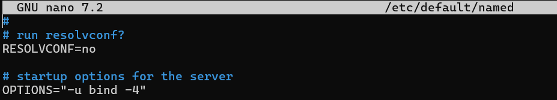

*Captura 17: Opciones de arranque de named con IPv4.*

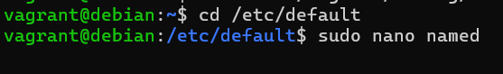

*Captura 18: Edición del archivo de opciones de arranque.*

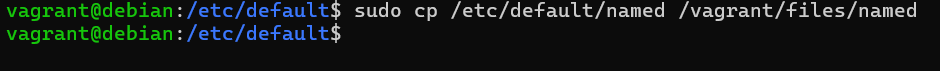

*Captura 19: Copia de named al directorio files.*

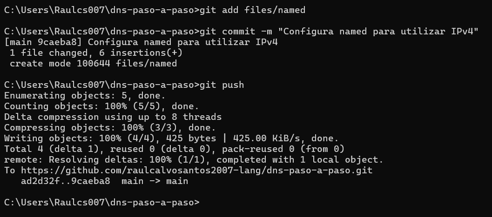

*Captura 20: Commit de la configuración IPv4.*

## 7. Opciones de BIND y equipos de confianza

**Debian, directorio `/etc/bind`:**

cd /etc/bind
sudo cp -n named.conf.options named.conf.options.backup
sudo nano named.conf.options

El archivo configurado contiene:

acl confiables {
    127.0.0.1;
    192.168.56.0/24;
};

options {
    directory "/var/cache/bind";
    allow-transfer { none; };
    listen-on port 53 { 127.0.0.1; 192.168.56.10; };
    recursion yes;
    allow-recursion { confiables; };
    dnssec-validation yes;
    // listen-on-v6 { any; };
};

La ACL incluye localhost y la red privada. `allow-recursion` limita a esos equipos las consultas recursivas y `allow-transfer` impide las transferencias de zona. BIND escucha las consultas en localhost y en la IP privada. DNS utiliza el puerto 53 mediante UDP y también TCP.

Mantengo `dnssec-validation yes` como en el enunciado y en mi captura. Los reenviadores permanecen comentados. La línea IPv6 comentada sigue el ejemplo, mientras que la restricción efectiva a IPv4 se establece con `-4` en las opciones de arranque.

sudo named-checkconf /etc/bind/named.conf.options
sudo systemctl restart named
sudo systemctl status named --no-pager
sudo cp /etc/bind/named.conf.options /vagrant/files/

La validación no devuelve mensajes cuando la sintaxis es correcta. El estado del servicio muestra `active (running)`.

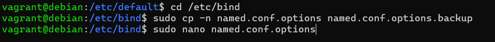

*Captura 21: Copia de seguridad y edición de las opciones.*

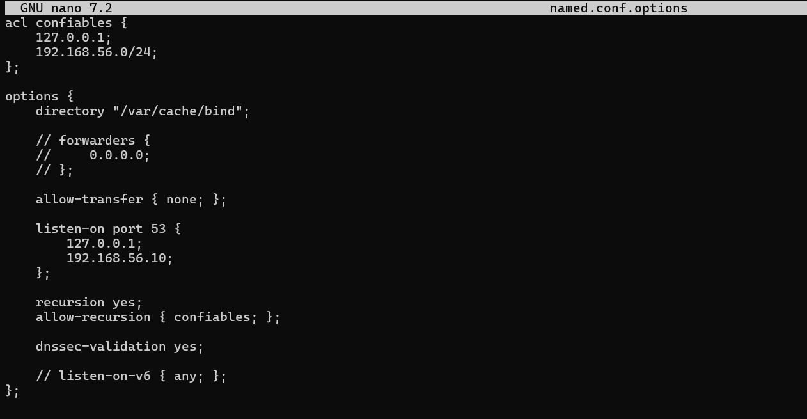

*Captura 22: ACL y opciones del servidor DNS.*

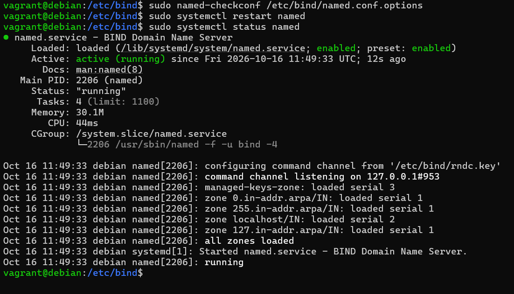

*Captura 23: Validación y reinicio correcto de named.*

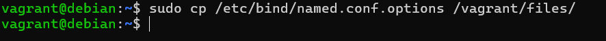

*Captura 24: Copia de las opciones al proyecto.*

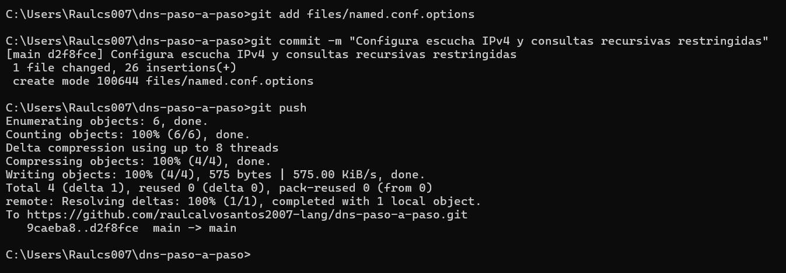

*Captura 25: Commit de las opciones de BIND.*

## 8. Declaración de las zonas

**Debian, directorio `/etc/bind`:**

sudo cp -n named.conf.local named.conf.local.backup
sudo nano named.conf.local

Configuré las dos zonas como maestras:

zone "raul.test" {
    type master;
    file "/var/lib/bind/raul.test.dns";
};

zone "56.168.192.in-addr.arpa" {
    type master;
    file "/var/lib/bind/raul.test.rev";
};

La zona directa traduce nombres a direcciones. La inversa utiliza los octetos de la red en orden inverso y permite obtener el nombre a partir de la IP.

sudo named-checkconf
sudo cp /etc/bind/named.conf.local /vagrant/files/

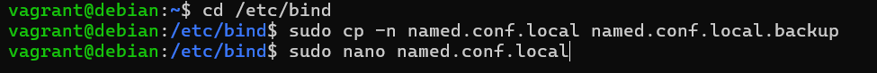

*Captura 26: Preparación del archivo de declaración de zonas.*

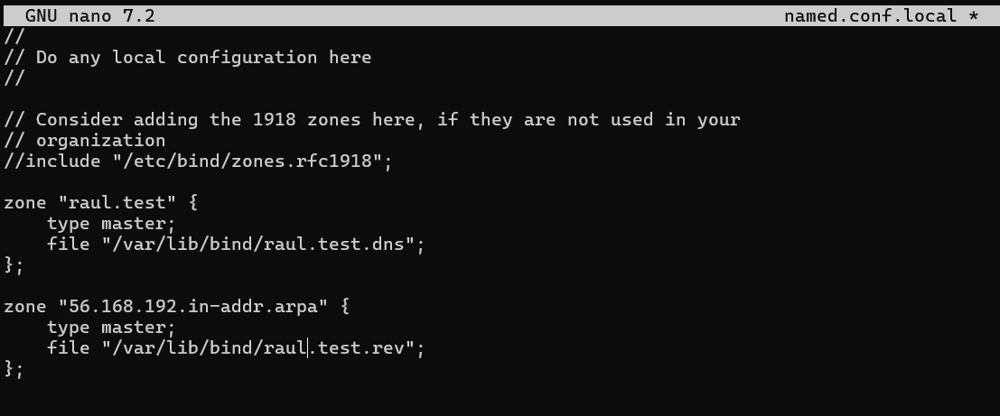

*Captura 27: Zonas directa e inversa declaradas.*

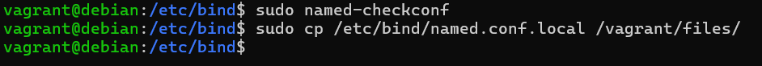

*Captura 28: Validación y copia de named.conf.local.*

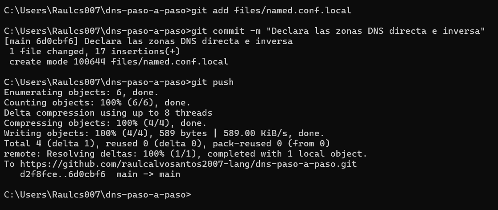

*Captura 29: Commit de la declaración de zonas.*

## 9. Zona directa

**Debian, directorio `/var/lib/bind`:**

cd /var/lib/bind
sudo nano raul.test.dns

La zona inicial contiene:

$TTL 86400
@ IN SOA debian.raul.test. admin.raul.test. (
    2026101501 ; Serial
    3600       ; Refresh
    1800       ; Retry
    604800     ; Expire
    86400      ; Negative Cache TTL
)
@       IN NS debian.raul.test.
debian  IN A  192.168.56.10

El registro SOA define los datos de administración de la zona y sus temporizadores. El NS identifica al servidor de nombres y el A asocia el equipo con su IPv4. `admin.raul.test.` representa la dirección de correo `admin@raul.test`. Los puntos finales evitan que BIND añada otra vez el nombre de la zona.

sudo chown root:bind /var/lib/bind/raul.test.dns
sudo chmod 644 /var/lib/bind/raul.test.dns
sudo named-checkzone raul.test /var/lib/bind/raul.test.dns
sudo cp /var/lib/bind/raul.test.dns /vagrant/files/

La comprobación devuelve `OK`. Al copiar el archivo cometí un error usando `tunombre.test.dns`; lo solucioné indicando el nombre real `raul.test.dns`.

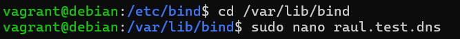

*Captura 30: Creación del archivo de zona directa.*

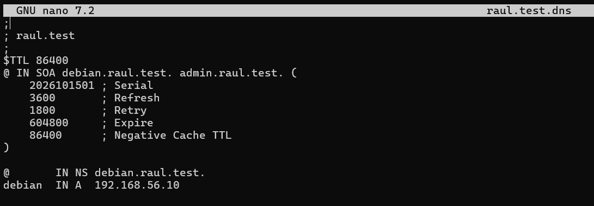

*Captura 31: Contenido inicial de la zona directa.*

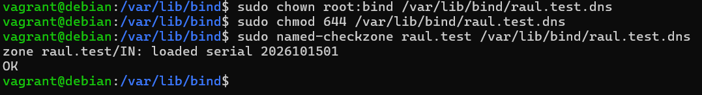

*Captura 32: Permisos y validación de la zona directa.*

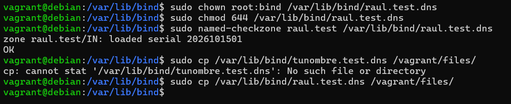

*Captura 33: Corrección del nombre al copiar la zona al proyecto.*

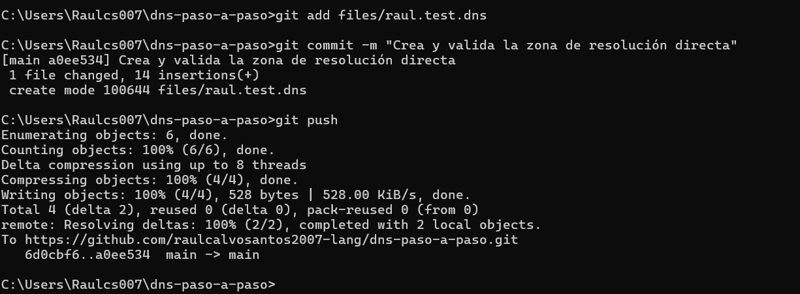

*Captura 34: Commit de la zona directa.*

## 10. Zona inversa y puesta en marcha

**Debian, directorio `/var/lib/bind`:**

sudo nano raul.test.rev

Contenido:

$TTL 86400
@ IN SOA debian.raul.test. admin.raul.test. (
    2026101501 ; Serial
    3600       ; Refresh
    1800       ; Retry
    604800     ; Expire
    86400      ; Negative Cache TTL
)
@   IN NS  debian.raul.test.
10  IN PTR debian.raul.test.

El registro `10` se corresponde con el último octeto de `192.168.56.10`.

sudo chown root:bind /var/lib/bind/raul.test.rev
sudo chmod 644 /var/lib/bind/raul.test.rev
sudo named-checkzone 56.168.192.in-addr.arpa /var/lib/bind/raul.test.rev
sudo named-checkconf -z
sudo systemctl restart named
sudo systemctl enable named
sudo systemctl status named --no-pager
sudo cp /var/lib/bind/raul.test.rev /vagrant/files/

Las zonas se cargan y el servicio permanece activo. Después consulté el registro A con `dig`.

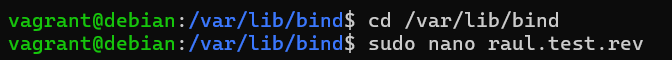

*Captura 35: Creación del archivo de zona inversa.*

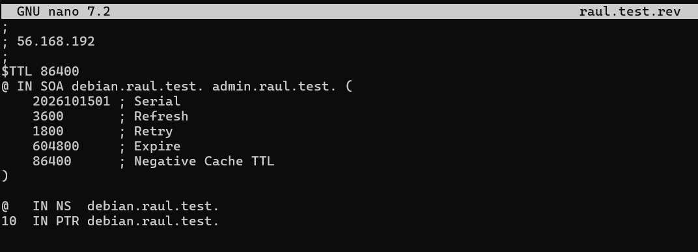

*Captura 36: Contenido del registro PTR.*

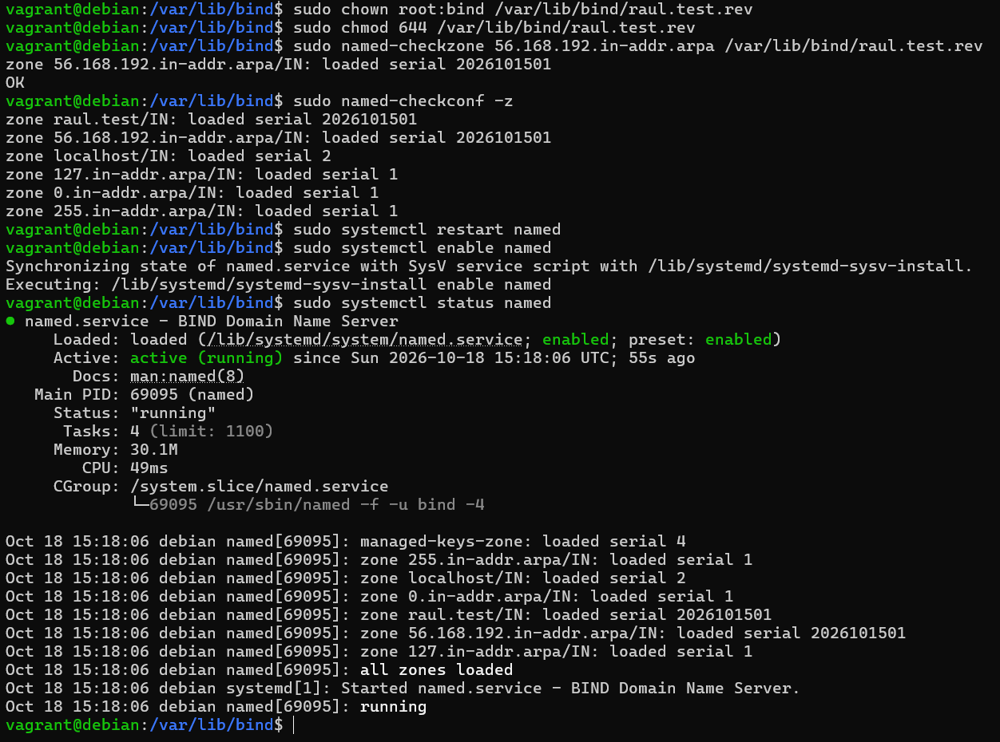

*Captura 37: Validación de zonas y estado del servicio.*

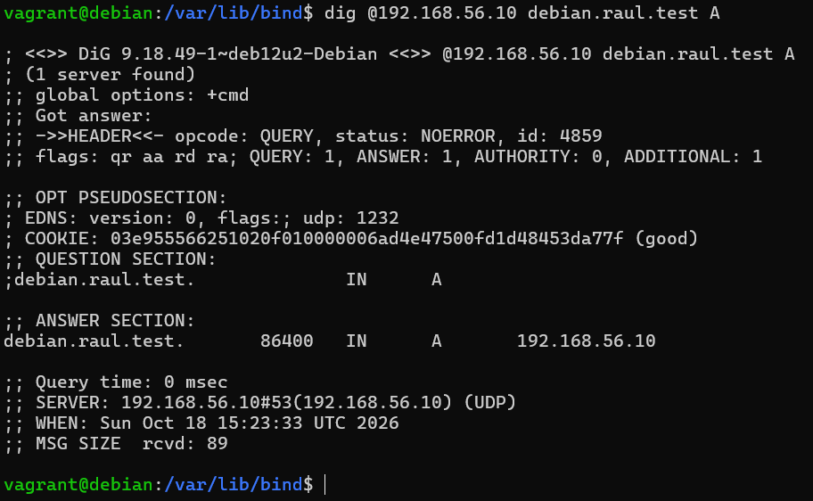

*Captura 38: Consulta directa con dig y respuesta autoritativa.*

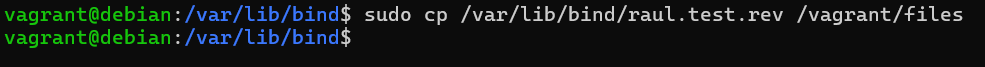

*Captura 39: Copia de la zona inversa al proyecto.*

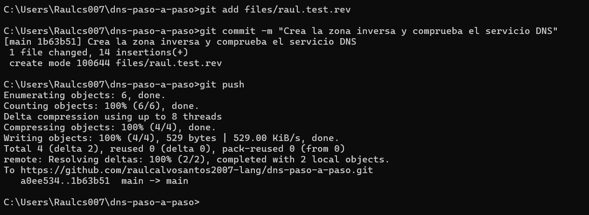

*Captura 38.0: Registro en Git de la zona inversa.*

*Captura 40: Evidencia adicional del mismo commit y envío.*

## 11. Consultas desde Debian y Windows

**Debian, cualquier directorio:**

nslookup debian.raul.test 192.168.56.10

**CMD de Windows, cualquier directorio:**

nslookup debian.raul.test 192.168.56.10
nslookup 192.168.56.10 192.168.56.10

En Windows no instalé `dnsutils`: utilicé `nslookup`, disponible en el sistema. La consulta directa devuelve `192.168.56.10` y la inversa devuelve `debian.raul.test`.

El enunciado pide además establecer este servidor como DNS del cliente. Se configura en las propiedades IPv4 del adaptador VirtualBox Host-Only, conservando su dirección IP y poniendo `192.168.56.10` como DNS preferido. Para comprobar el DNS utilizado por defecto:

ipconfig /flushdns
nslookup debian.raul.test

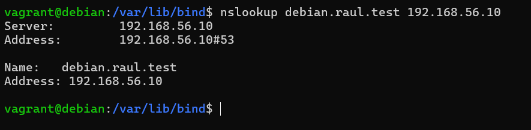

*Captura 41: Consulta mediante nslookup en Debian.*

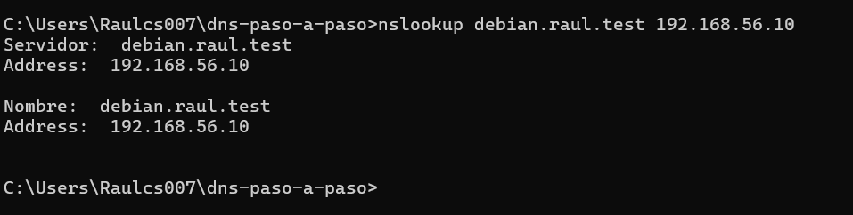

*Captura 41.0: Consulta al servidor DNS desde el cliente Windows.*

## 12. Ampliación: CNAME, TXT y PTR

**Debian, archivo `/var/lib/bind/raul.test.dns`.** Incrementé el serial a `2026101502` y añadí:

web IN CNAME debian.raul.test.
@   IN TXT   "raulcalvosantos2007-lang"

El CNAME crea un alias para el servidor y el TXT contiene mi usuario de GitHub. Crear el alias DNS no instala un servidor web; permite resolver su nombre.

sudo named-checkzone raul.test /var/lib/bind/raul.test.dns
sudo systemctl restart named
sudo cp /var/lib/bind/raul.test.dns /vagrant/files/

En la copia volví a utilizar inicialmente el marcador `tunombre`; la captura muestra la corrección posterior al nombre real.

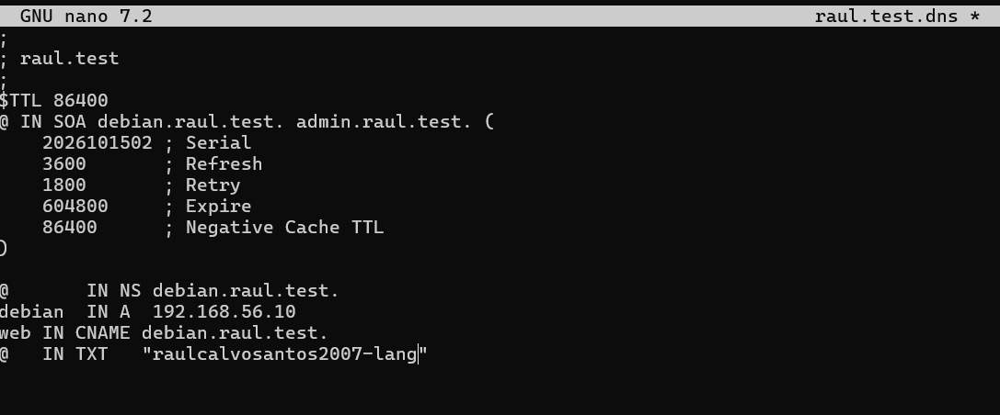

*Captura 42: Zona directa con el serial actualizado, CNAME y TXT.*

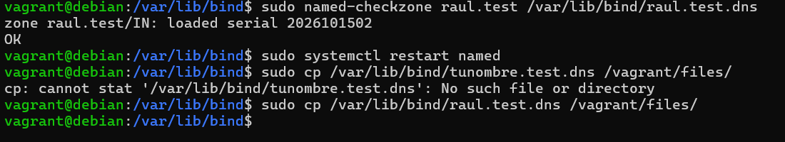

*Captura 43: Validación y copia de la zona ampliada.*

**CMD de Windows:**

nslookup -type=cname web.raul.test 192.168.56.10
nslookup -type=txt raul.test 192.168.56.10
nslookup 192.168.56.10 192.168.56.10

| Registro | Respuesta comprobada |
| --- | --- |
| CNAME | `debian.raul.test` |
| TXT | `"raulcalvosantos2007-lang"` |
| PTR | `debian.raul.test` |

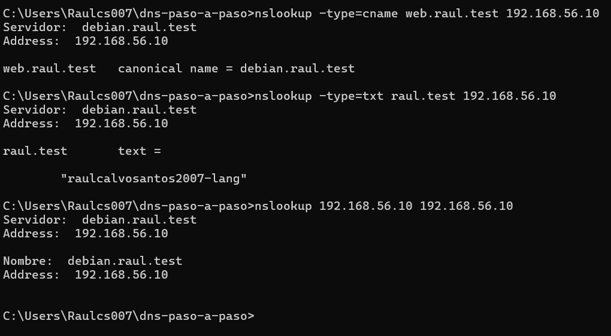

*Captura 44: Consultas CNAME, TXT y PTR desde Windows.*

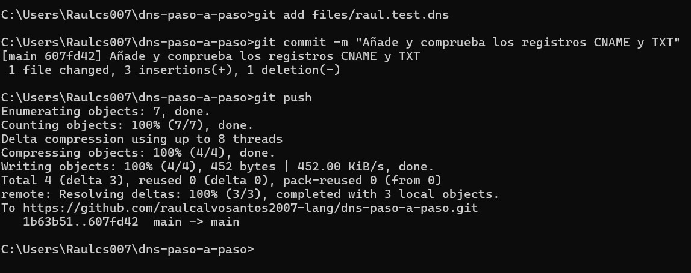

*Captura 45: Commit de los registros ampliados.*

## 13. Consulta local, externa y autoridad

Intenté usar en CMD una sintaxis de `dig` con `nslookup`. No son intercambiables y el comando mostró la ayuda de uso. Para comparar las cabeceras utilicé `dig` dentro de Debian.

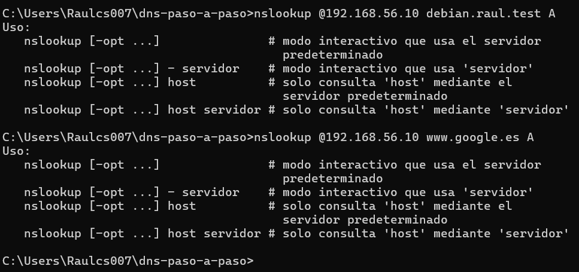

*Captura 46: Intento con sintaxis incorrecta de nslookup en Windows.*

**Debian, cualquier directorio:**

dig @192.168.56.10 debian.raul.test A
dig @192.168.56.10 www.google.es A

En la consulta local aparece `aa` en la línea `flags`, mientras que en la externa los flags son `qr rd ra`. La consulta externa devuelve `NOERROR` y una dirección IP de Google (`172.217.20.227` en la captura). Esto confirma que funciona la resolución externa en esa prueba y no fue necesario añadir reenviadores para continuar.

**El flag `aa` aparece en la consulta local porque mi servidor es autoritativo para `raul.test`, y no aparece en la externa porque no es autoritativo para el dominio consultado.**

La captura siguiente permite comparar ambas cabeceras; `aa` se encuentra en la línea de flags de la primera respuesta.

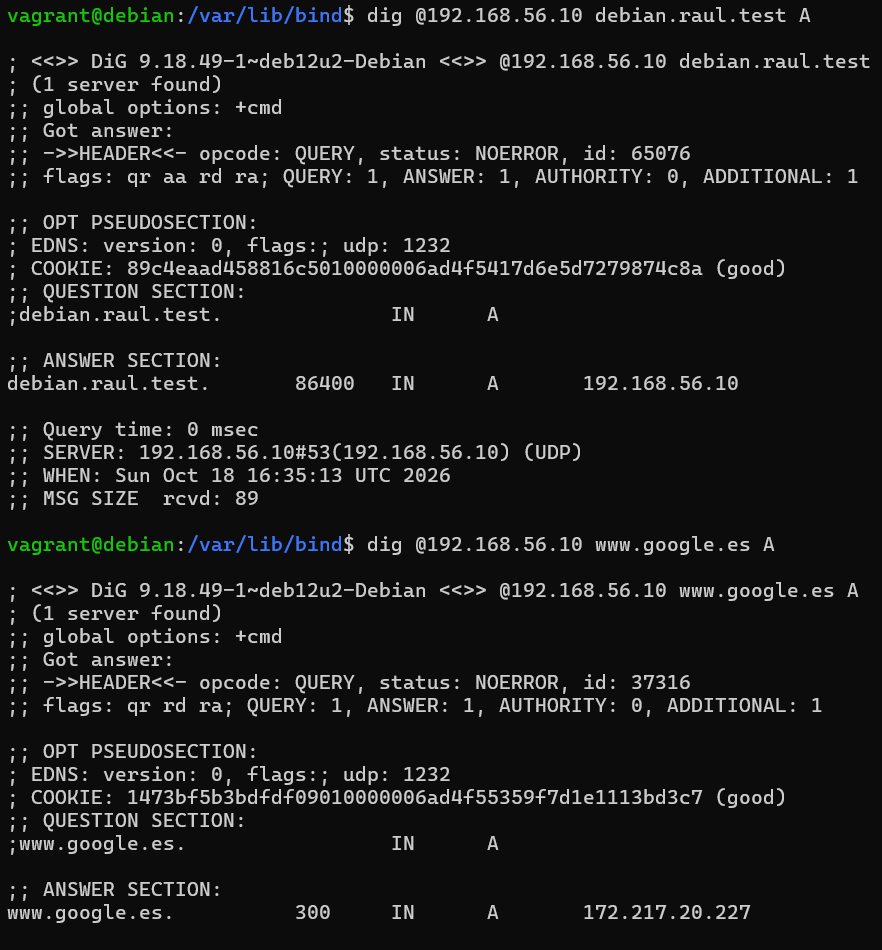

*Captura 47: Comparación de la consulta local autoritativa y la externa sin aa.*

## 14. Script de autocomprobación

**CMD de Windows, directorio del proyecto:**

notepad test.sh

El script se guarda en la raíz del repositorio y se ejecuta en Debian. 

#!/usr/bin/env bash
set -euo pipefail

DOMINIO="raul.test"
IP="192.168.56.10"
INVERSA="56.168.192.in-addr.arpa"
USUARIO="raulcalvosantos2007-lang"
RUTA_ZONAS="/var/lib/bind"

comprobar() {
    local descripcion="$1"
    local esperado="$2"
    local obtenido="$3"
    if [[ "$obtenido" == "$esperado" ]]; then
        echo "[OK] $descripcion"
    else
        echo "[ERROR] $descripcion"
        printf 'Esperado: %s\nObtenido: %s\n' "$esperado" "$obtenido"
        exit 1
    fi
}

named-checkconf -z
named-checkzone "$DOMINIO" "$RUTA_ZONAS/$DOMINIO.dns"
named-checkzone "$INVERSA" "$RUTA_ZONAS/$DOMINIO.rev"
systemctl is-active --quiet named

comprobar "Registro A" "$IP" \
    "$(dig @127.0.0.1 "debian.$DOMINIO" A +short +time=2 +tries=1)"
comprobar "Registro CNAME" "debian.$DOMINIO." \
    "$(dig @127.0.0.1 "web.$DOMINIO" CNAME +short +time=2 +tries=1)"
comprobar "Registro TXT" "\"$USUARIO\"" \
    "$(dig @127.0.0.1 "$DOMINIO" TXT +short +time=2 +tries=1)"
comprobar "Registro PTR" "debian.$DOMINIO." \
    "$(dig @127.0.0.1 -x "$IP" +short +time=2 +tries=1)"

echo "Todas las comprobaciones han terminado correctamente."

**Debian, directorio `/vagrant`, después de guardar la versión corregida:**

cd /vagrant
sed -i 's/\r$//' test.sh
chmod +x test.sh
sudo bash ./test.sh

`sed` elimina los finales de línea de Windows. 

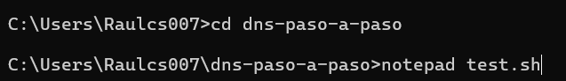

*Captura 48: Creación de test.sh con el Bloc de notas.*

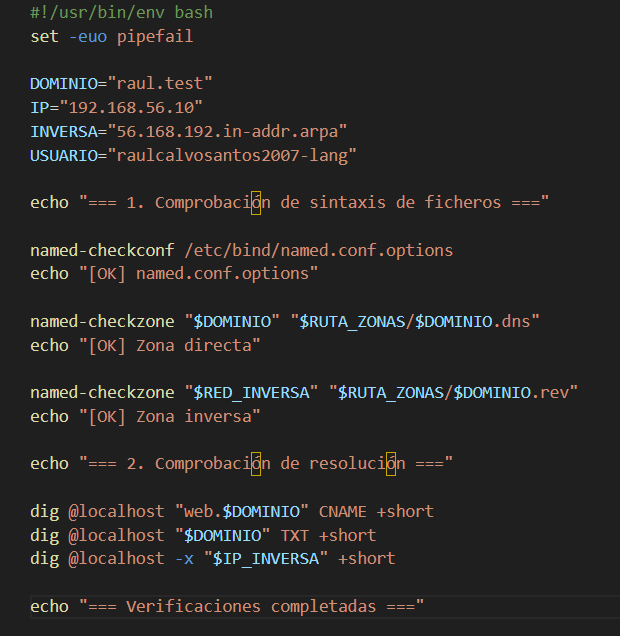

*Captura 49: Contenido capturado del script con referencias que deben corregirse.*

*Captura 50: Asignación de permiso de ejecución desde Git Bash.*

*Captura 51: Commit y envío del script a GitHub.*

## 15. Provisión automática

La provisión se divide en tres scripts: instalar los paquetes, copiar las configuraciones y ejecutar las pruebas.

### 15.1. Configuración del servicio

**Windows, directorio del proyecto:**

notepad config\02-configurar.sh

#!/usr/bin/env bash
set -euo pipefail

install -o root -g root -m 644 \
    /vagrant/files/named /etc/default/named

install -o root -g bind -m 644 \
    /vagrant/files/named.conf.options /etc/bind/named.conf.options

install -o root -g bind -m 644 \
    /vagrant/files/named.conf.local /etc/bind/named.conf.local

install -d -o root -g bind -m 775 /var/lib/bind

install -o root -g bind -m 644 \
    /vagrant/files/raul.test.dns /var/lib/bind/raul.test.dns

install -o root -g bind -m 644 \
    /vagrant/files/raul.test.rev /var/lib/bind/raul.test.rev

named-checkconf -z

systemctl enable named
systemctl restart named
systemctl is-active --quiet named

Uso `install` para copiar los archivos con propietario, grupo y permisos definidos. La comprobación se hace antes de reiniciar el servicio.

*Captura 52: Apertura del script de configuración.*

*Captura 53: Script capturado con rutas de ejemplo pendientes de sustituir.*

### 15.2. Última fase: ejecución de pruebas

**Windows, archivo `config/03-comprobar.sh`:**

#!/usr/bin/env bash
set -euo pipefail
bash /vagrant/test.sh

Vagrant ejecuta estos provisionadores con privilegios de administrador dentro de Debian.

*Captura 54: Creación del último script de provisión.*

*Captura 55: Llamada al script de autocomprobación.*

### 15.3. Vagrantfile final

**Windows, archivo `Vagrantfile` en la raíz del proyecto:**

Vagrant.configure("2") do |config|
  config.vm.box = "debian/bookworm64"
  config.vm.hostname = "debian"
  config.vm.network "private_network", ip: "192.168.56.10"

  config.vm.provider "virtualbox" do |vb|
    vb.memory = 1024
    vb.cpus = 1
  end

  config.vm.provision "shell", path: "config/01-instalar.sh"
  config.vm.provision "shell", path: "config/02-configurar.sh"
  config.vm.provision "shell", path: "config/03-comprobar.sh"
end

Los scripts se ejecutan en ese orden. Antes de ejecutarlos, debo confirmar que todos los archivos de `files/` están actualizados y que los scripts se han guardado con finales de línea LF.

**Debian, si los scripts se editaron en Windows:**

cd /vagrant
sed -i 's/\r$//' config/*.sh test.sh

**CMD de Windows, directorio del proyecto:**

git add Vagrantfile config/ test.sh files/
git update-index --chmod=+x test.sh config/01-instalar.sh config/02-configurar.sh config/03-comprobar.sh
git commit -m "Corrige las rutas y variables de la provision DNS"
git push
vagrant validate
vagrant provision

*Captura 56: Vagrantfile con los tres provisionadores.*

*Captura 56.0: Apertura del Vagrantfile desde CMD.*

*Captura 57: Commit de la automatización y permisos ejecutables.*

## 16. Comprobación desde una máquina nueva

**CMD de Windows, directorio del proyecto.** Para probar la reproducibilidad, primero hay que guardar los archivos importantes en el proyecto. Después:

vagrant destroy
vagrant up

`vagrant destroy` elimina la máquina virtual y solicita confirmación; no es el comando de apagado normal. Para apagar conservando la máquina se utiliza `vagrant halt`.

La captura muestra la destrucción de la máquina y el comienzo de una nueva importación. No muestra el final de la provisión ni la ejecución de todas las pruebas, por lo que no puedo dar por confirmado el despliegue completo a partir de esa imagen.

*Captura 58: Eliminación de la máquina y comienzo de un nuevo despliegue.*

*Captura 59: Intento de commit sin cambios nuevos en la documentación.*

La salida `nothing to commit, working tree clean` de la última captura significa que no había modificaciones que registrar. No acredita una nueva comprobación del despliegue.

